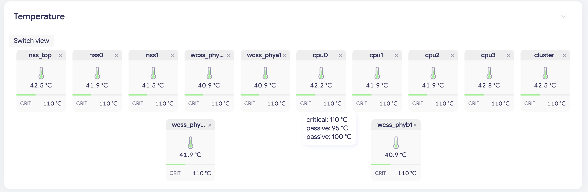
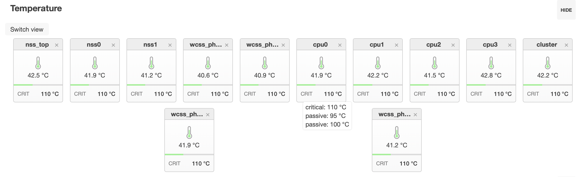
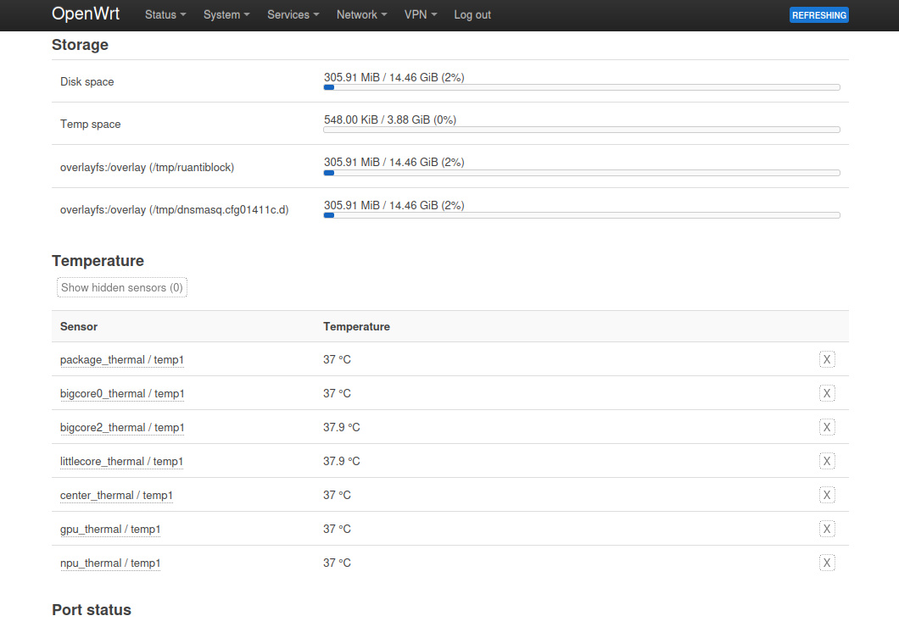
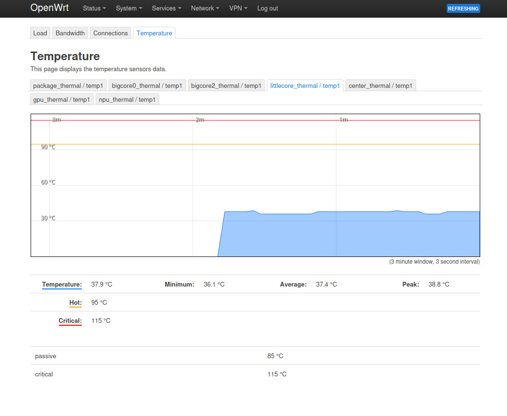

## luci-app-temp-status
#### (Modified version based on [gSpotx2f/luci-app-temp-status](https://github.com/gSpotx2f/luci-app-temp-status))

Temperature sensors data for the LuCI status page (OpenWrt webUI): a block on **Status → Overview**, plus a **Temperature** tab on **Status → Realtime Graphs** with a live chart per sensor.

Card view, Argon theme.

Card view, Bootstrap theme.

### Overview of changes
- New **card** view for the Temperature block on the overview page, and it is now the default view
- Cards reuse the theme's own `.ifacebox` classes, so they look like the Port status cards and follow the active theme (light and dark)
- **Switch view** cycles through `table` → `list` → `card`; the table and list views are exactly the upstream ones
- A card shows the sensor name (without the `_thermal` suffix), a thermometer icon, the temperature, a gauge bar and the limit temperature in the bottom row (`CRIT`, `MAX` or `EMERG`)
- The gauge is filled in proportion to that limit and turns yellow (hot) or red (overheat); the colors follow the Port status zone colors (slightly brighter in the dark theme)
- Long names are cut off with an ellipsis instead of wrapping; hover the name to see the full sensor name
- Hover the bottom row to see all trip points of the sensor (`critical`, `passive`, ...)
- Cards are narrow (about 104 px), spread over the full page width, and a short last row is centered
- The × on a card hides the sensor, **Show hidden sensors** brings them back (same as upstream)
- Spacing of the **Switch view** button bar tightened and aligned with the section title

### Screenshots of the original views

Table view (upstream).

Realtime Graphs → Temperature (upstream).

### Installation
Requires OpenWrt >= 25.12 (apk). Dependencies: `ucode`, `ucode-mod-fs`.

Download the `.apk` of the latest [release](https://github.com/OneNAS-space/luci-app-temp-status/releases) and install it:

    apk --allow-untrusted add /tmp/luci-app-temp-status-*.apk

The package clears the LuCI caches and reloads `rpcd` itself when it is installed or upgraded. If the page still looks the same afterwards, force-refresh the browser once (Ctrl+F5).

Only the main package is built, no `luci-i18n-*` language packages.

### How this repository is maintained
The upstream source is not edited by hand; this repository follows it automatically.

| Branch / path | Content |
|---|---|
| `Official-original` | An untouched copy of the upstream repository |
| `main` | The upstream code with our patches applied, plus the files we keep ourselves |
| `local-patches/` | Our patches (`*.patch`), applied in file-name order |

A scheduled workflow (`Auto-sync-original.yml`, every 6 hours, and on every change of `local-patches/`) fetches the upstream, refreshes `Official-original`, applies the patches on top and pushes the result to `main`. If a patch no longer applies cleanly the workflow stops and `main` is left untouched.

`README.md`, `LICENSE`, `SECURITY.md`, `screenshots/` and `.github/` are ours and are never overwritten by the sync.

The release number follows the sync: within one upstream version, `PKG_RELEASE` goes up by one for every change of the shipped files (new upstream commits or changed patches), and a push to `main` that changes the `Makefile` builds and publishes a new release. When upstream raises `PKG_VERSION`, `PKG_RELEASE` follows upstream again.

### License
MIT, same as upstream.
